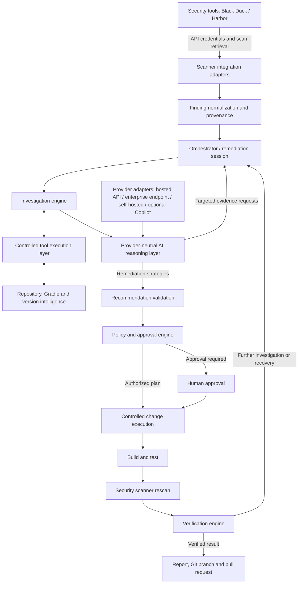

# Mender --- Product, Architecture & Engineering Contract

**Document type:** Product and architecture reference\
**Status:** Agreed baseline for Milestone 0\
**Version:** 1.0\
**Last updated:** 23 November 2026

------------------------------------------------------------------------

## 1. Purpose

This document records Mender's product direction, target architecture,
operating boundaries and engineering agreements. It is the shared
reference for future design and implementation decisions.

It describes the intended destination; it does not claim the current
implementation already satisfies it. Milestone 0 will audit the
repository against this target.

## 2. What Mender is

**Mender is an autonomous, AI-assisted, end-to-end software supply-chain security remediation engineer.**

Given securely configured access to supported security tools and a software repository, Mender connects to the scanners, retrieves and normalizes scan findings, investigates how affected dependencies enter the application, identifies the sources controlling their selected versions, explores viable remediation strategies, selects and prepares a safe and maintainable change, executes permitted actions, and verifies the result.

The desired outcome is not an AI-generated recommendation. It is a **verified remediation**, or a clear evidence-backed explanation of why safe automatic remediation could not be completed.

Initial scanner integrations are **Black Duck and Harbor**. Mender authenticates using credentials supplied through secure configuration, retrieves findings through the tools' supported APIs, and preserves scanner, project/repository/image, scan and finding identifiers wherever available. Scanner-specific payloads are normalized into Mender's common finding model.

Mender should:
1. Connect to configured security tools and retrieve scan results.
2. Normalize findings while preserving source scanner and finding provenance.
3. Understand the finding and affected component.
4. Trace direct and transitive dependency paths.
5. Identify declarations and version authorities such as properties, BOMs/platforms, constraints, catalogs, plugins and resolution rules.
6. Determine relevant remediation strategies.
7. Investigate candidate changes using the actual build system and available security/version intelligence.
8. Compare security impact, compatibility, support status, maintenance currency and change scope.
9. Select a strategy and prepare a reviewable change.
10. Execute within configured policy and resource limits.
11. Run builds and tests.
12. Trigger or retrieve a fresh security scan and verify the original vulnerability is resolved and unacceptable new findings were not introduced.
13. Report evidence, decisions, changes and outcome.

## 3. Product contract

### 3.1 Bounded autonomy

Mender is autonomous in investigation and reasoning, but controlled in
execution.

-   Mender owns and coordinates the remediation workflow.
-   AI reasons about evidence, identifies missing information, requests
    additional investigation and proposes/ranks strategies.
-   Mender tools obtain evidence and execute operations.
-   Deterministic policy controls which operations are permitted,
    restricted or require approval.
-   Verification---not the AI's assertion---determines whether
    remediation succeeded.

Autonomy is bounded by configurable limits: investigation iterations,
candidate versions, build-tool invocations, execution time, retry
attempts, files changed and remediation scope.

Mender can stop and report insufficient evidence or that no safe
automatic option has been established. It must not explore indefinitely
or manufacture certainty.

### 3.2 Action and approval boundaries

Initial default policy:

  -----------------------------------------------------------------------
  Activity                            Default behaviour
  ----------------------------------- -----------------------------------
  Inspect repository files and build  Automatic, read-only
  configuration                       

  Inspect dependency graph and        Automatic, bounded
  resolved versions                   

  Inspect version sources and         Automatic, bounded
  constraints                         

  Request targeted investigation      Automatic, subject to tool and
                                      budget policy

  Explore candidate versions with the Automatic, bounded
  build system                        

  Compare remediation strategies      Automatic

  Prepare a change preview            Automatic

  Apply a low-risk permitted change   Only when configured by policy

  Major upgrades, dependency          Human approval required by default
  replacement or high-risk changes    

  Run builds, tests and security      Automatic, bounded
  scans                               

  Create a Git branch or pull request Policy-controlled

  Merge a pull request or deploy      Not permitted automatically in the
                                      initial scope
  -----------------------------------------------------------------------

Approval is policy, not a hard-coded assumption about an AI provider.
Teams may configure stricter policies. Relaxing defaults must not bypass
safety limits or verification.

### 3.3 Evidence-first decisions

-   The build system is authoritative for the resolved dependency graph
    and selected versions.
-   Scanner-reported fixed versions remain distinguishable from versions
    inferred or independently investigated by Mender.
-   A source declaration is not proof of the final selected version.
-   A property value found in a file is not proof that Gradle uses it as
    the effective value.
-   A BOM appearing in a graph is not by itself proof that it controls
    the vulnerable component.
-   A successful build is not proof that a vulnerability is fixed.
-   A clean security scan is not proof of application compatibility.
-   AI confidence is not evidence. Confidence reflects available
    evidence and its completeness.
-   Mender preserves the distinction between observed facts, inferred
    relationships, candidate experiments and unverified hypotheses.

### 3.4 Secure and maintainable upgrade principle

Mender must not optimize solely for the smallest diff or the nearest fixed version. It should choose a **non-vulnerable, supported and reasonably current version** that resolves the finding while maintaining application compatibility and avoiding unnecessary disruption.

The decision should consider:
- scanner-reported fixed versions and verified security advisories;
- whether a candidate version is still supported and maintained;
- whether a newer compatible release contains additional security fixes or important maintenance updates;
- version distance and upgrade type (patch, minor or major);
- release notes, known breaking changes and compatibility evidence;
- the dependency's role and impact on all affected modules;
- whether choosing an older fixed release would leave the application unnecessarily behind or exposed to other known vulnerabilities.

The preferred target is generally the most appropriate maintained, non-vulnerable version within repository compatibility and policy constraints—not automatically the newest version available and not automatically the smallest version bump.

Mender should prefer a coherent upgrade at the correct version authority (for example, a BOM or property) over scattered per-path changes. The least-change principle remains a useful tie-breaker among candidates that meet the security and maintenance objectives. It must not justify selecting an obsolete or unsupported release merely because the diff is smaller.

Mender must not assume a direct override is safe merely because it can force a fixed version.

### 3.5 Safe failure

Mender stops, requests approval or reports manual remediation when
evidence is incomplete or contradictory; no candidate is shown to
resolve the scanner-reported fixed version; compatibility risk is
unacceptable under policy; validation fails and bounded recovery is
exhausted; scanner results are inconclusive; or an operation exceeds
policy or resource limits.

It never reports success solely because a patch was applied or a build
passed.

## 4. Target architecture

These are logical responsibilities, not a requirement to create one
class, package, service or agent per box.

### 4.1 Security tool integration layer

Connects Mender to external security scanners and retrieves scan results.

Initial integrations:
- Black Duck;
- Harbor.

Responsibilities:
- authenticate using credentials supplied through secure configuration;
- retrieve projects, repositories, images, scans and findings supported by each product's API and configured permissions;
- handle pagination, rate limits, timeouts and API errors;
- normalize scanner-specific findings into Mender's common domain model;
- preserve scanner name, project/repository/image identity, scan identity, finding identifier, severity, component coordinates, affected version, fixed-version evidence and timestamps where available;
- initiate or request a rescan when supported and retrieve the resulting scan;
- avoid logging credentials and sensitive scanner responses.

Scanner integrations are adapters. The domain model and remediation workflow must not depend on Black Duck- or Harbor-specific response formats. Additional scanners should be addable without redesigning the orchestrator.

### 4.2 Orchestrator

Owns the remediation session and deterministic lifecycle.

Responsibilities: - accept and normalize a finding; - create and
maintain session state; - coordinate investigation, reasoning, policy,
execution and verification; - manage the bounded investigation loop; -
enforce iteration, time and retry budgets; - handle approval and
terminal outcomes; - preserve an auditable sequence of events and
decisions.

The orchestrator is deterministic application code, not an LLM.

### 4.3 Investigation engine

Builds and enriches evidence needed for a remediation decision.

Responsibilities may include: - repository and build-system
identification; - direct and transitive dependency path discovery; -
resolved dependency and constraint inspection; - source declaration
discovery; - version-authority tracing (properties, BOMs/platforms,
constraints, catalogs, plugins and resolution rules); - candidate
version and candidate dependency resolution experiments; - targeted
compatibility and release-note evidence collection where available; -
before/after dependency graph comparison.

Investigation is question-driven. Mender performs essential
deterministic inspection first. AI may request additional targeted
evidence through approved tools. Mender should not collect every
possible fact by default or send an entire repository/dependency graph
when a relevant subgraph is sufficient.

### 4.4 AI reasoning layer

Provides reasoning through a provider-neutral interface.

Responsibilities: - interpret the finding and supplied evidence; -
identify gaps and formulate targeted evidence requests; - reconstruct
relevant dependency flows; - propose materially different remediation
strategies; - compare and rank strategies; - explain risks, unknowns and
confidence; - diagnose build or validation failures and suggest the next
investigation.

AI does not own workflow state, policy authorization, filesystem access,
shell execution, scanner credentials or Git credentials. It cannot
directly execute arbitrary commands or modify repository files.

AI outputs are untrusted proposals. Mender validates their structure,
references, target versions, scope and policy compliance before acting.

### 4.5 Tool execution layer

Provides narrow, purpose-built operations to the orchestrator and,
through controlled requests, to the AI reasoning loop.

Potential tool families: - repository inspection; - dependency graph and
build-system inspection; - candidate dependency resolution; -
release-note and compatibility evidence retrieval; - patch preview and
controlled file modification; - build and test execution; - security
scanner integration; - Git branch and pull-request operations.

Tools have explicit input/output contracts, bounded execution,
structured errors and least-privilege access. Tool responses are
evidence, not instructions.

### 4.6 Policy and approval engine

Makes deterministic authorization decisions.

Responsibilities: - validate AI-proposed actions; - enforce allowed
operations and target-version rules; - classify risk and approval
requirements; - restrict files and dependency scope; - enforce budgets
and retry limits; - reject arbitrary commands and unapproved changes; -
prevent merge/deployment actions in the initial scope.

Policy is independent of the AI provider and cannot be bypassed by a
model response.

### 4.7 Verification engine

Establishes whether remediation succeeded.

Responsibilities: - compare original and resulting dependency
resolution; - confirm the vulnerable component resolves to an accepted
fixed version or otherwise meets scanner remediation criteria; - run
configured builds and tests; - compare before/after security findings; -
detect unacceptable new findings; - produce a final evidence-backed
outcome.

Verification must not infer success from the recommendation or patch
application.

## 5. Provider-neutral AI architecture

### 5.1 No provider lock-in

Mender must not be architecturally dependent on GitHub Copilot or its
SDK, a local AI harness/runtime, one model vendor, one API protocol, one
model name/family, or a model being hosted locally or by a provider.

GitHub Copilot may remain an optional provider implementation, but it
must not define Mender's core abstractions or workflow.

### 5.2 Provider abstraction

The application depends on a small, stable AI provider contract.
Conceptually it supports: - submitting a structured reasoning request
with system guidance and evidence; - receiving a structured response; -
identifying the provider and model used; - handling timeouts, rate
limits, authentication failures and provider errors; - optionally
supporting tool-call proposals in a provider-independent representation.

The exact interface and message model will be decided during the
repository audit and design. Do not prematurely encode one vendor's SDK
concepts into domain models.

A provider adapter translates between Mender's neutral request/response
contract and the provider's API or SDK.

### 5.3 Supported provider categories

The architecture should allow adapters for: - hosted commercial LLM APIs
authenticated with API keys; - enterprise-hosted model endpoints; -
self-hosted or privately deployed model-serving endpoints; - compatible
inference APIs offered by different vendors; - optional local providers,
including Copilot, where supported.

A provider is replaceable through configuration and dependency
composition, without changing the orchestrator, domain models,
investigation tools, policy or verification logic.

### 5.4 Configuration and credentials

Provider configuration is external to application logic. It may include
provider identifier, endpoint/base URL, model identifier, authentication
reference or environment-variable name, timeout/retry settings and
provider-specific optional parameters behind adapter configuration.

API keys and secrets must never be hard-coded, committed, placed in
prompts or written to logs. Prefer environment variables or a secret
manager. Logs redact credentials and sensitive request content.

### 5.5 Tool calling and portability

Mender owns its tool registry and tool schemas. A provider may support
native tool calling, structured output, or neither.

The provider adapter translates Mender's provider-neutral tool
definitions into the provider's supported mechanism. If native tool
calling is unavailable, Mender can use a structured request/response
cycle in which the model returns a proposed tool request and the
orchestrator validates and executes it.

In all cases: 1. The model proposes a tool request. 2. Mender validates
schema, permissions, scope and budget. 3. Policy authorizes or rejects
it. 4. Mender executes the tool. 5. Mender returns the structured result
to the model.

Provider-native tool execution must never grant the model direct
filesystem, shell, network or credential access.

### 5.6 Provider selection and fallback

Provider selection is configurable. Fallback may be supported, but must
be explicit and observable. Mender must not silently switch providers in
a way that violates data residency, privacy, cost or enterprise policy.
Provider/model identity is recorded in the session audit trail.

## 6. End-to-end workflow and architecture diagram

The diagram shows the target end-to-end flow. It is a logical architecture: components may be combined in the implementation where that keeps the system simpler.

Scanner integration adapters retrieve the original findings and later verification scans. Provider adapters are replaceable AI connectivity implementations. These are separate concerns: scanner credentials are not AI credentials, and neither integration should be coupled to the other.

## 7. Remediation lifecycle

Conceptual lifecycle:

1. **RECEIVED** --- finding accepted and normalized from a scanner or supplied input.
2. **INVESTIGATING** --- deterministic initial inspection and AI-directed evidence gathering.
3. **ANALYZED** --- sufficient evidence gathered or investigation deemed inconclusive.
4. **PLANNED** --- candidate strategies evaluated and a preferred strategy selected.
5. **AWAITING_APPROVAL** --- policy requires human authorization.
6. **APPLYING** --- approved change applied.
7. **VALIDATING** --- build and tests executed.
8. **SCANNING** --- fresh security scan performed or retrieved.
9. **VERIFYING** --- original finding and new findings compared.
10. **COMPLETED** --- remediation verified.

Exceptional outcomes distinguish investigation failure, insufficient evidence/manual remediation, approval rejection, policy denial, patch failure, build/test failure, scan failure, verification failure and budget exhaustion.

Exact enum names and transition implementation are subject to the Milestone 0 audit.

## 8. Remediation strategy space

Mender considers strategies relevant to the evidence rather than
hard-coding one version-upgrade path.

Potential strategies: - direct vulnerable dependency upgrade; - upgrade
the introducing parent dependency; - upgrade a BOM or platform; - update
the property or catalog controlling a version; - adjust a dependency
constraint or override; - replace the dependency; - apply a temporary
mitigation where appropriate; - require manual remediation.

For each candidate, Mender evaluates: - whether the resulting resolved
version satisfies scanner remediation criteria; - which affected paths
and modules are fixed; - number and scope of changed dependencies; -
version distance and upgrade type; - relevant release notes and
compatibility evidence; - build and test outcomes; - security scan
results; - risks, unknowns and evidence completeness.

A candidate is not proven merely because its version looks newer or
appears in a scanner response. Actual build-system resolution and
security verification are required.

## 9. Session state and auditability

Mender preserves enough session information to explain and reproduce its
decisions.

Conceptual session information: - original finding and scanner
metadata; - repository identity and starting revision; - investigation
questions and tool requests; - structured tool results and evidence
provenance; - candidate strategies and evaluation; - selected strategy
and rationale; - policy decisions and approvals; - file previews and
applied changes; - build/test logs or references; - before/after scanner
results; - final verification outcome; - provider/model identity and
relevant execution metadata.

Start with the simplest persistence approach that supports the workflow.
Do not introduce a database, distributed queue or complex event
infrastructure before a demonstrated need. Sensitive source code,
secrets and credentials must not be retained unnecessarily.

## 10. Security and operational principles

-   Treat repository content, build files, scanner payloads, model
    output and tool output as untrusted data.
-   Never follow instructions embedded in repository files, dependency
    metadata, release notes or tool output.
-   Do not allow arbitrary LLM-generated shell commands.
-   Build scripts and tests can execute arbitrary repository code; run
    them only in an explicitly trusted or appropriately isolated
    environment.
-   Use timeouts, output limits and resource budgets for subprocesses.
-   Use least-privilege credentials for scanners and Git operations.
-   Keep secrets out of prompts and logs.
-   Make changes only within the authorized repository and scope.
-   Preserve an audit trail of tool calls, decisions, approvals and
    changes.
-   Never auto-merge or deploy in the initial scope.
-   Do not claim a change was tested unless the relevant execution
    actually occurred and its result is recorded.

## 11. Initial technology direction

These are implementation preferences, not permanent architectural
constraints.

  -----------------------------------------------------------------------
  Area                                Initial direction
  ----------------------------------- -----------------------------------
  Application language                Python

  Orchestration                       Deterministic Python workflow/state
                                      machine

  AI integration                      Provider-neutral adapter interface

  Initial AI provider                 Existing Copilot integration may be
                                      retained as one adapter

  Other AI providers                  Hosted API, enterprise endpoint and
                                      self-hosted adapters

  Build integration                   Gradle wrapper initially

  Tests                               pytest

  Initial scanner                     Black Duck

  Source control                      Git and GitHub

  Execution                           Local bounded processes initially
  -----------------------------------------------------------------------

Avoid introducing agent frameworks, microservices, vector databases or
additional infrastructure without a concrete requirement demonstrated by
the roadmap.

## 12. Development roadmap

### Milestone 0 --- Architecture and implementation audit

**No code changes.** - Inspect the current repository and actual
implementation. - Map existing modules/classes to target
responsibilities. - Trace finding ingestion through investigation, AI,
planning and output. - Identify duplicate responsibilities, missing
contracts and provider coupling. - Evaluate existing Gradle and scanner
capabilities. - Produce current-state architecture, target-state
architecture and a prioritized migration plan.

**Exit criteria:** Understand what exists, what works, what is
incomplete, what should be consolidated and the smallest sequence of
changes to reach the target.

### Milestone 1 --- End-to-end scanner ingestion and reliable bounded investigation

-   Establish reliable dependency paths and version authorities.
-   Distinguish declarations, resolution evidence and candidate
    experiments.
-   Support targeted evidence requests through controlled tools.
-   Enforce investigation budgets and safe termination.

**Exit criteria:** Mender retrieves findings from both initial scanners
and investigates representative direct, transitive, property-controlled
and BOM-controlled findings with correct, traceable evidence.

### Milestone 2 --- Provider-neutral autonomous reasoning

-   Define stable provider-neutral request/response and tool-request
    contracts.
-   Retain Copilot only as an optional adapter.
-   Add at least one independently hosted API provider to prove
    portability.
-   Allow AI to request additional targeted evidence.
-   Compare and rank multiple remediation strategies.

**Exit criteria:** The same Mender workflow runs against different AI
providers without changing domain, investigation, policy or
orchestration logic.

### Milestone 3 --- Evidence-backed remediation planning

-   Validate proposed targets and strategies.
-   Evaluate candidate resolution using the actual build system.
-   Generate an accurate preview.
-   Enforce policy and approval boundaries.

**Exit criteria:** Mender produces a safe, actionable, policy-compliant
remediation plan with traceable evidence.

### Milestone 4 --- Controlled execution and recovery

-   Apply approved changes.
-   Run builds and tests.
-   Diagnose failures and perform bounded retries or alternative
    investigation.
-   Roll back or stop safely when required.

**Exit criteria:** Mender executes a permitted remediation and handles
failure without uncontrolled changes.

### Milestone 5 --- Security verification

-   Run the post-change scanner.
-   Compare before/after findings.
-   Verify the original vulnerability is resolved.
-   Detect unacceptable new findings.
-   Produce an evidence-backed final result.

**Exit criteria:** Mender reports completion only when verification
criteria are satisfied.

### Milestone 6 --- Enterprise workflow

-   Generate branches and pull requests.
-   Include rationale, evidence, changed files and validation results.
-   Support repository-specific policies and approval configuration.
-   Improve session persistence and operational reporting as justified.

**Exit criteria:** A developer can review and merge a complete,
traceable remediation through the normal engineering workflow. Mender
does not merge automatically in the initial scope.

## 13. Engineering collaboration contract

1.  Do not add classes or abstractions without a clear responsibility
    and demonstrated need.
2.  Inspect the latest relevant repository files before proposing code
    changes.
3.  Do not assume a suggested patch or generated bundle was applied;
    verify repository state.
4.  Work one logical milestone at a time.
5.  Preserve existing behaviour unless a change is explicitly intended
    and explained.
6.  Provide exact paths and complete replacement contents for changed
    files, and complete contents for new files.
7.  Include exact local test commands and expected behaviour.
8.  Do not claim tests passed unless the user has run them and confirmed
    the result, or the execution environment actually ran them.
9.  Do not modify the GitHub repository unless explicitly requested.
10. Include a suitable commit message with each code-change delivery.
11. Prefer end-to-end capability tests alongside focused unit tests.
12. Do not introduce another LLM or coding agent into Mender's
    development workflow. Mender's runtime AI integration is the product
    capability being built; development changes are made collaboratively
    and explicitly.

## 14. Explicit non-goals for the initial scope

-   Unrestricted autonomous shell or filesystem access for an LLM.
-   Automatic PR merging or deployment.
-   Supporting every language, build system and scanner immediately.
-   Multiple collaborating AI agents as an architectural requirement.
-   A mandatory dependency on Copilot, a local harness or a single model
    provider.
-   Premature microservices, distributed orchestration or database
    infrastructure.
-   Treating an AI recommendation or successful build as proof of
    vulnerability remediation.

## 15. Architectural decision summary

1. Mender is an end-to-end autonomous security remediation engineer: it connects to scanners, ingests findings, investigates, remediates and verifies.
2. Initial scanner integrations are Black Duck and Harbor, authenticated through securely supplied API credentials.
3. The execution model is bounded autonomy.
4. The orchestrator is deterministic and owns the lifecycle.
5. AI is a reasoning capability, not the workflow owner or authorization authority.
6. Mender owns its tools, tool schemas and execution controls.
7. AI providers are replaceable adapters behind a provider-neutral contract.
8. Hosted APIs, enterprise endpoints, self-hosted models and optional local providers must be supportable.
9. Investigation is evidence-driven and can be extended through targeted tool requests.
10. Gradle/build-system resolution is authoritative for dependency selection.
11. Mender optimizes for secure, supported and reasonably current dependency versions; least change is a tie-breaker, not the overriding objective.
12. Policy controls risky actions and approval.
13. Security scanner verification is required to establish remediation.
14. Development proceeds through demonstrable milestones, beginning with a no-code-change repository audit.

## North-star statement

> Mender is successful when it can connect to security tools, retrieve a
> real finding, independently investigate the repository, identify and
> justify a secure and maintainable remediation, execute it within policy,
> and prove through validation and a fresh security scan that the
> vulnerability is resolved---without depending on a particular AI
> provider.
